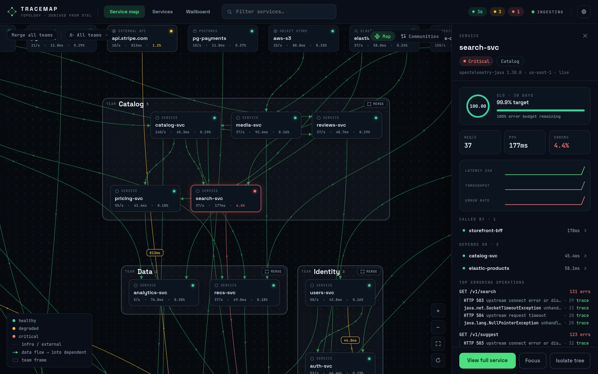
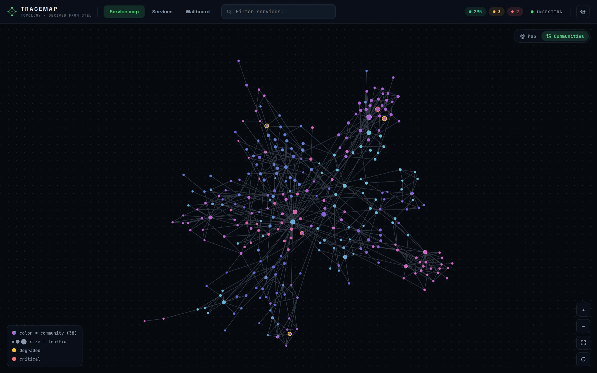
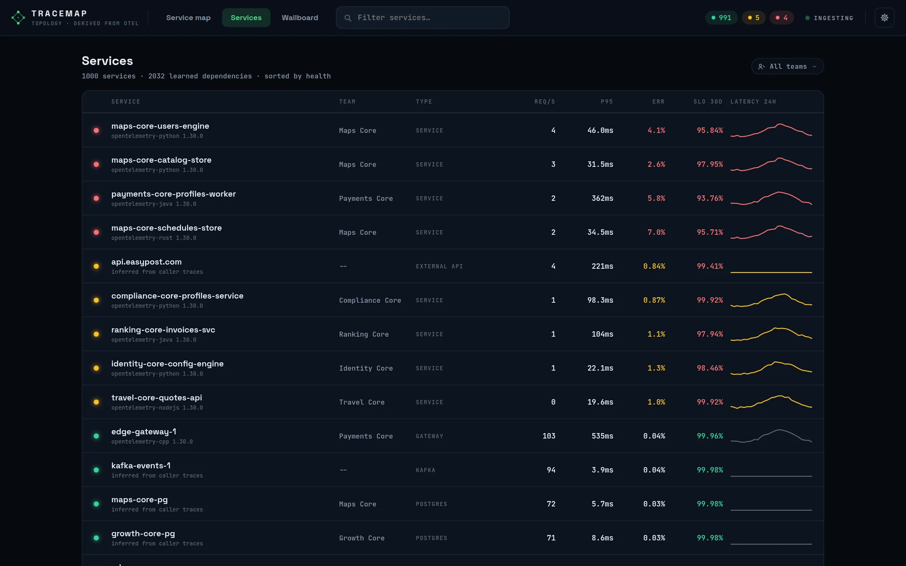
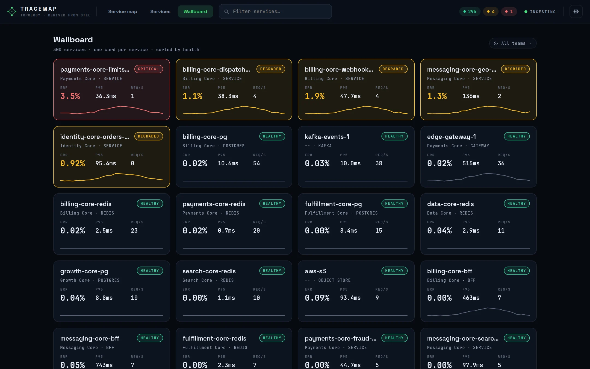
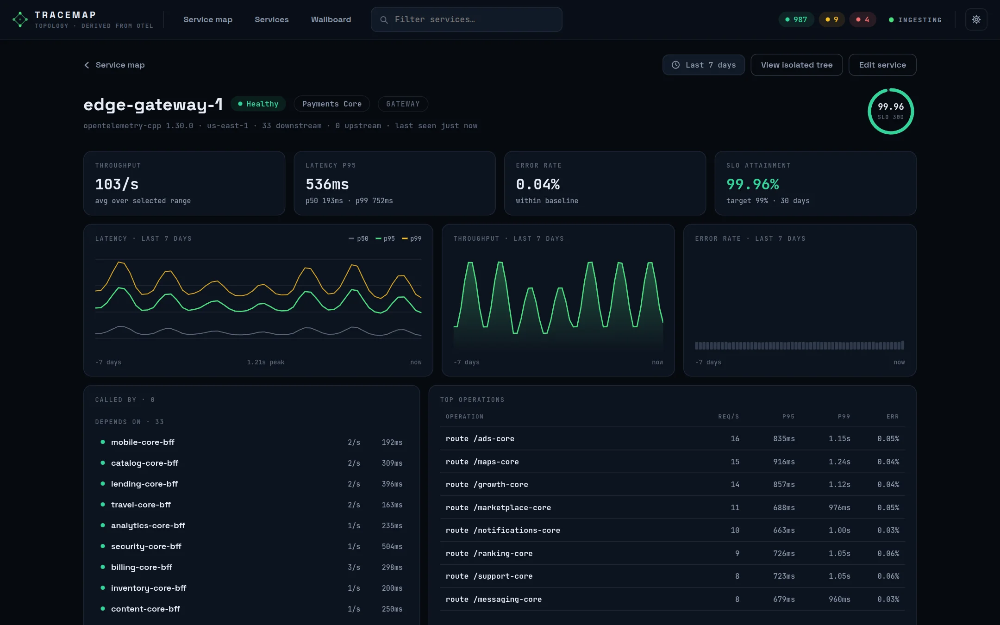
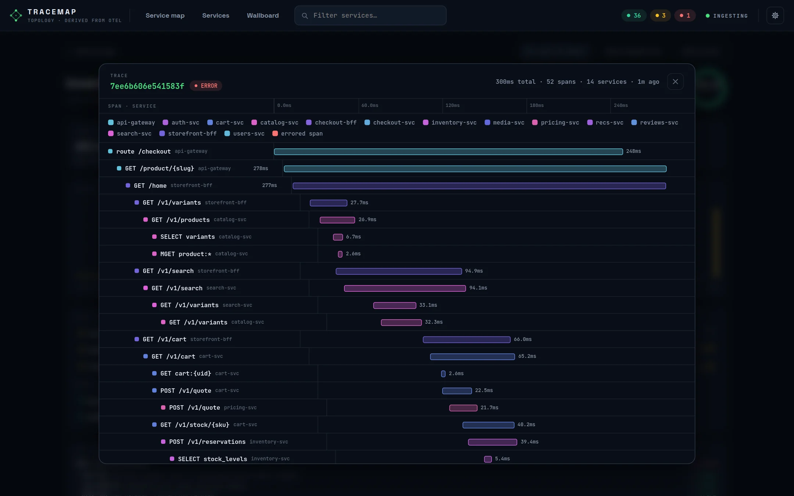

# Features

What each part of the UI does, in more detail than the [README](../README.md).

- [Service map](#service-map)
- [Teams](#teams)
- [Map and communities](#map-and-communities)
- [Header health counts](#header-health-counts)
- [Inspector drawer](#inspector-drawer)
- [Services list](#services-list)
- [Wallboard](#wallboard)
- [Service pages](#service-pages)
- [Trace waterfall](#trace-waterfall)
- [Manual curation](#manual-curation)
- [Preferences](#preferences)
- [Deep links](#deep-links)

## Service map



The map is a live graph of every known service, internal and external, and every
learned caller to dependency edge. You can pan and zoom it. It needs no date
selection: it always shows the current state of everything, or the last known
state of services with no recent traffic.

Health shows as color on node borders and edges: green, amber, red.

Edges show the direction of data flow. Glowing packets travel from each dependency
into the service that depends on it, and the edge ends in an arrowhead at the
dependent. Packet density follows the traces being received. An edge with no
current traffic, or only stale metrics, goes quiet, and a busier edge carries more
packets.

Edge anchors follow direction too. Each edge attaches to the side of a node that
faces its counterpart, and edges that share a side fan out instead of meeting at
one point. Direction stays readable in cyclic graphs and after you drag nodes.

You can drag nodes to new positions. Edges follow, the positions persist in the
browser, and the reset-layout button restores the default layout.

The camera frames itself:

- It fits the whole graph on load.
- It centers on a selected node at a readable zoom, clear of the drawer. This
  applies to clicks and to deep links.
- It reframes onto the dependency cone when you focus or isolate.

When you zoom too far out to read text, cards hide their labels and a "zoom in to
read labels" hint appears. The zoom level where labels appear is a
[preference](#preferences).

### Large fleets

The map changes how it draws as the fleet grows, so it stays responsive:

- Below a zoom of about 0.5, the whole map is drawn on one canvas. Above it, cards
  are mounted only for the services on screen. A fleet of 150 nodes or fewer
  keeps its cards at every zoom.
- From 300 services, teams start collapsed, so the first view is a few hundred
  team nodes instead of thousands of services. Add `?teams=expanded` to the URL
  to start with every team open.
- As more edges come into view, healthy edges fade and unhealthy ones gain
  strength, so the amber and red edges stay visible in a dense mesh.

## Teams

Each service belongs to an owning team. TraceMap assigns the team from the
`team.name` OTEL resource attribute when a service reports one, creating the team
if needed. You can also assign teams in the UI or through the API.

An unmerged team's services sit together inside a labeled frame, like a box on an
infrastructure diagram. The frame's title bar shows the team name and member
count, and has a merge button. Dragging the title bar moves the whole team.

Merging collapses a team into a single node. "Merge all teams" turns hundreds of
nodes into a team-depends-on-team view, and you can unmerge any one team again for
a closer look. External dependencies stay individual until you assign them to a
team.

Merge changes happen in place. A team keeps its spot on the map when toggled,
including teams you have dragged, and other frames shift only enough to avoid
overlap. On small and mid-size maps the change animates: merged services converge
into their team node, and unmerged services fly back out.

Merging teams usually makes the graph cyclic, because most teams end up depending
on each other. The layout breaks those cycles with a greedy feedback-arc ordering,
so the dominant flow still runs top to bottom and only a few edges point up.

## Map and communities



A toggle in the top right switches the map between two layouts.

**Map** is the default layered dependency-flow view described above.

**Communities** is a force-directed graph drawn on a canvas. Services are dots
sized by traffic and colored by community. Labels appear on hover, on selection,
or when you zoom in. Community colors stay in cool hues, cyan through magenta, so
they cannot be confused with the red, amber and green of a status ring.

TraceMap detects communities with label propagation over the call graph. It uses
structure only, so communities stay stable between metric updates and shift only
when the topology changes. They show clusters of tightly coupled services,
whatever team owns them.

The simulation settles before the first paint and stays cool until you drag a
node, so an idle graph costs no CPU.

Both views share selection, focus, search, the team filter and the inspector
drawer. The team filter is a searchable dropdown: type to narrow the list, then
pick a team, or "Unassigned" for services with no owner. The services list and
wallboard use the same filter.

## Header health counts

The healthy, degraded and critical counts in the top bar are a way into triage.
Click the degraded or critical count to list exactly those services, worst first
by error rate and then tail latency. Pick one to jump to the map with that service
selected, the camera on it and its drawer open. Escape or a click outside closes
the list.

## Inspector drawer

Click any node, team node or edge to inspect it. The drawer shows:

- SLO attainment and remaining error budget.
- Requests per second, p95 latency and error rate.
- 24-hour sparklines. Hovering one moves the crosshair on all of them, so you can
  compare the same instant.
- Callers and dependencies.
- For an edge, the learned relationship: first observed, supporting spans,
  confidence, and whether it was learned or added by hand. Also the mix of
  operations seen on it.
- The top erroring operations. Under each, the distinct errors seen, such as
  exception types, HTTP status codes and queue or database error codes, with exact
  counts. Each error links to a kept sample trace when one exists.

The drawer footer has two ways to cut the map down to what matters:

- **Focus** dims everything outside the selection's dependency cone and keeps the
  rest on screen.
- **Isolate**, on the layered map, redraws the map for that node, team or edge's
  dependency tree alone. Isolation is a deep link (`?isolate=<key>`). A banner at
  the top has an Exit button that returns to the full map, and each service page
  has a "View isolated tree" action. The communities view offers focus only.

## Services list



A sortable table of every service: health, traffic, p95, error rate, 30-day SLO
and a 24-hour latency sparkline. It ranks the worst health first. The team filter
scopes the table to one team or to unassigned services, and the search box in the
header narrows it by name. Only the visible rows are rendered, so the table works
the same at 5,000 services.

## Wallboard



`/wallboard` shows the same services, filters and ranking as the list, as a grid
of cards you can read from across a room. Each card has the service's status,
error rate, p95, requests per second and 24-hour latency sparkline, and the whole
card is tinted when the service is degraded or critical.

Clicking a card slides in the same inspector as the map's drawer. Its dependency
rows jump between cards, and its footer links to the full service page or to the
map isolated to that service's tree.

## Service pages



A page per service with:

- KPI cards.
- Latency, throughput and error-rate charts. Hover tooltips stay in sync across
  the three.
- Top operations.
- Upstream and downstream services, linked.
- Top erroring operations with the distinct errors seen. Clicking an operation
  filters the recent traces to that operation's failures. Click it again, or the
  filter chip, to clear.
- Recent kept traces, each marked with why it was kept: error, slow or baseline.

A date and time picker with quick ranges or absolute from and to scopes everything
on the page.

Each section loads on its own behind a skeleton, and the chart bundle is
code-split, so the page shell paints at once instead of waiting on one combined
request.

## Trace waterfall



Click a trace to open the full distributed span tree, with timing bars and the raw
OTEL attributes of each span. Only kept traces can be opened. See
[limits](../README.md#limits).

## Manual curation

You can correct what inference gets wrong:

- Rename a service, and set its description, owning team, type and SLO target.
- Add a dependency the inference cannot see.
- Merge duplicate services, where one service reports under different names, into
  one canonical service. The old name becomes an alias for all future traffic, and
  its history appears under the canonical service.

The duplicate picker is the same searchable dropdown used elsewhere. It lists only
services with no team, because an assigned service is owned on purpose and is not
a stray duplicate.

Merges are reversible. TraceMap records each merge, so the edit dialog lists
everything merged into a service, and an Unmerge button splits a duplicate back
out with its service, history and edges.

## Preferences

The cog in the header opens the preferences:

- Theme, dark or light.
- Map labels: how far you must zoom in before node labels show. The choices are
  Always, Zoomed out, Default and Zoomed in, and they apply to both map views.

Preferences persist in localStorage under `tracemap.prefs`.

## Deep links

Every view has a URL, so it survives a reload and you can share it as a link. The
browser's back and forward buttons move between views.

```
/                     service map (layered dependency flow)
/communities          service map (force-directed, clustered by community)
/services             services list
/service/<id>         service detail
/wallboard            wallboard (one card per service)

?trace=<id>           open a trace in the modal overlay (any view)
?range=q.<ms>         quick time range  (e.g. q.3600000 = last 1 hour)
?range=a.<from>.<to>  absolute time range (epoch ms)
?team=none|<id>       team filter (omitted when "all teams")
?isolate=<key>        render only this node, team or edge's dependency tree
                      (layered map only; ignored on every other view)
?teams=expanded       start with every team unmerged (read once, on load)
```

Default values, a 24-hour range and all teams, are left out of the URL. Serving
the app needs the usual single-page fallback to `index.html`. The bundled
`web/nginx.conf` and the Vite dev server both do this.

There is no routing library. `web/src/state/routing.ts` encodes the state and
`urlSync.ts` binds it to the History API.
